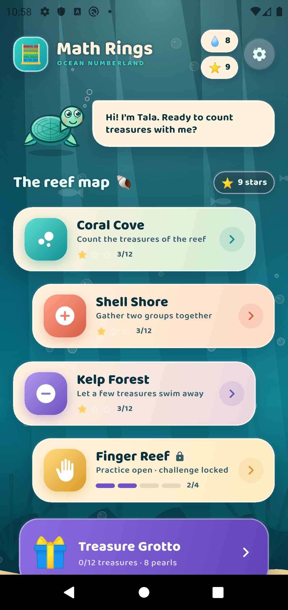
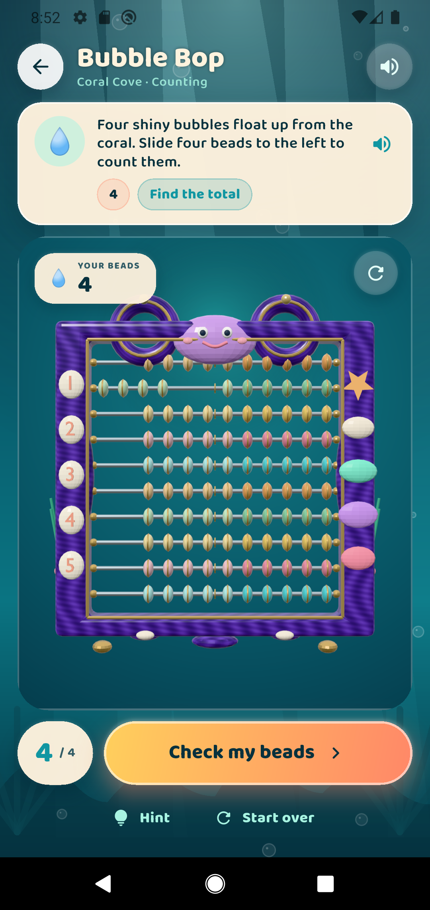
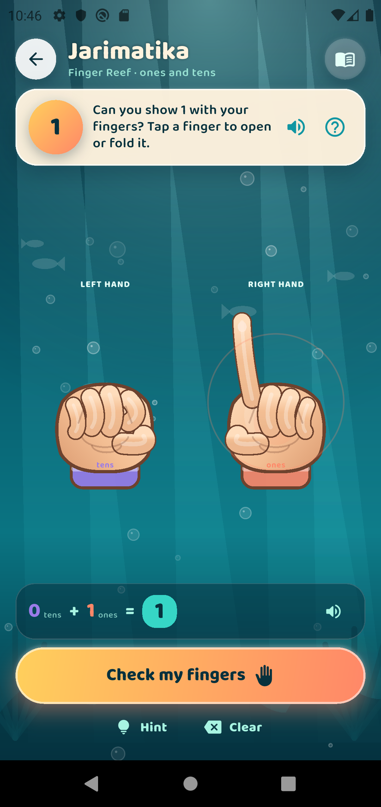
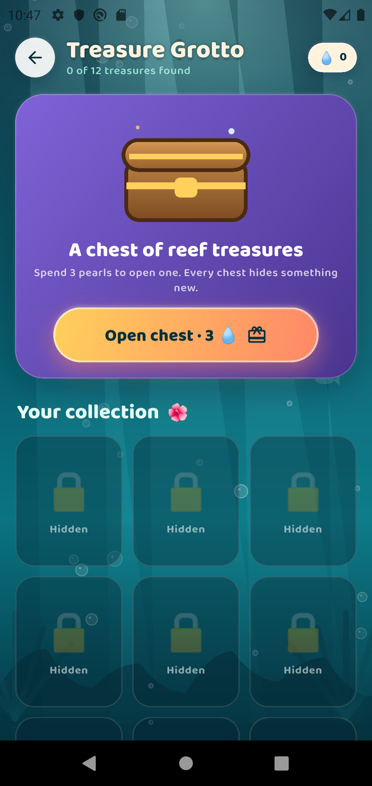

# Math Rings — Ocean Numberland

A complete, playable early-childhood maths game built with Flutter. Children
count real 3D beads on a Kecrekan abacus, add and subtract with the same
instrument, learn Jarimatika finger maths, collect pearls, and open treasure
chests in an ocean world guided by Tala the turtle.



## What is in the game

- **Sixteen hand-written missions** across four reef stations, plus open-ended
  free play. Missions never time out and never punish a wrong answer.
- **A real interactive 3D Kecrekan abacus.** The scene is loaded from
  `assets/3d/kecrekan/kecrekan.glb`; every one of the 100 beads is its own
  glTF node with a spring solver, raycast picking, drag, tap, snap and reset.
  There are no painted or flattened substitute beads.
- **Jarimatika finger maths** with the canonical one-hand shapes, left hand for
  tens and right hand for ones. Fingers can be opened and folded by tapping.
- **Evidence-based progression**, persistent stars, pearls, treasures, sound,
  voice and ambience settings.
- **Audio, voice and animation everywhere:** bead clicks, group-of-five chimes,
  bubble pops, success fanfares, chest opening, turtle speech with
  `flutter_tts`, and a looping ocean ambience.
- **Responsive phone and tablet layout**, portrait locked.

## The four reef stations

| Station | Skill | Missions (targets) |
| --- | --- | --- |
| Coral Cove | Counting | Bubble Bop (4), Shell Search (7), Fish Parade (10), Crab Count (6) |
| Shell Shore | Addition | Two Pearl Piles (2 + 3), Starfish Pair (4 + 3), High Five (5 + 5), Coral Climb (6 + 2) |
| Kelp Forest | Subtraction | Bubble Pop (8 − 3), Shells Away (10 − 4), Kelp Snack (7 − 2), Turtle Trek (9 − 5) |
| Finger Reef | Jarimatika | Three Fingers, Six Magic Fingers, Eight in a Row, Ten at Last |

Each station also has **free play**: no timer, no score, no wrong answers.

Mission answers are hidden while playing (`2 + 3 = ?`), and the completed
equation is revealed on the reward sheet. Counting missions show a bead-count
challenge instead of a spoiler target.

## The 3D Kecrekan is the maths

The maths state in `lib/kecrekan/kecrekan_math.dart` is the single source of
truth. Ten rows each hold ten beads; `rodCounts` drives every bead position.

- Counted beads pack against the **screen-left** of the frame; uncounted beads
  pack against the **screen-right**. The half-bead gap in the middle makes a
  five split readable at a glance.
- **Tap** a bead to slide it one place (count it, or send a counted bead back).
- **Drag** a bead to move several places at once.
- The spring solver in `kecrekan_controller.dart` gives each bead weight and
  snaps it cleanly to the nearest slot.
- **Reset** returns the frame to the mission's starting number.
- The running total is always the sum of the ten row counts.



## Jarimatika rules

Right hand counts ones, left hand counts tens. Both hands use the same shape.

| Number | Fingers open |
| --- | --- |
| 1 | index |
| 2 | index + middle |
| 3 | index + middle + ring |
| 4 | index + middle + ring + pinky |
| 5 | thumb |
| 6 | thumb + index |
| 7 | thumb + index + middle |
| 8 | thumb + index + middle + ring |
| 9 | all five |

For a two-digit number, make the tens shape on the left hand and the ones shape
on the right, e.g. 34 = left hand 3, right hand 4.

Finger Reef has two layers:

- **Practice is always unblocked.** A child can open the hands screen and keep
  working on any number from day one.
- The **challenge missions** unlock only with mastery evidence: at least three
  first-try counting answers, two first-try addition answers, one first-try
  subtraction answer, and eight total stars. Mission count alone is not enough,
  and the mastery panel on the station shows the exact goals still missing.



## Rewards and persistence

- First-try success awards **3 stars and 2 pearls**; a retry still earns stars
  and 1 pearl. Progress is best-score based, so replaying cannot lose stars.
- Pearls open chests in **Treasure Grotto** (3 pearls each) and unlock one of
  twelve collectible reef treasures.
- Everything is saved with `shared_preferences` under
  `math_ocean.progress.v1` and restored on launch: stars, pearls, treasures,
  mastered first tries, seen tips and audio settings.
- Settings include sound effects, voice guide and ocean ambience toggles.



## Running the app

```bash
flutter pub get
flutter run -d <device-id> --enable-flutter-gpu
```

Requirements: Flutter 3.47 or newer (Dart 3.13), Android SDK with a device or
emulator that supports OpenGL ES / Vulkan for `flutter_scene`.

Build an APK:

```bash
flutter build apk --release
```

The Android application id is `com.mathocean.math_ocean`. The launcher icon is
generated from `assets/images/app-icon.svg`; the splash uses the same pearl-ring
mark on deep water (`android/app/src/main/res/drawable*/launch_background.xml`
and `values-v31/styles.xml`).

## Project layout

```
lib/
  main.dart                     app bootstrap, portrait lock, progress load
  app.dart                      ocean theme, audio lifecycle, provider scope
  core/
    catalog.dart                missions, stories, voices, treasures
    models.dart                 Mission/Station models and prompt helpers
    progress.dart               save data, mastery evidence, chest logic
    audio_service.dart          SFX pool, looping ambience, TTS guide
    feedback.dart               haptics
  kecrekan/
    kecrekan_math.dart          pure bead maths and left/right packing
    kecrekan_controller.dart    GLB load, camera, picking, spring simulation
    kecrekan_stage.dart         live 3D widget, gestures, loading/error states
  jarimatika/
    hand_painter.dart           hand geometry, Jarimatika shapes, hit testing
  screens/
    home_screen.dart            reef map, turtle greeting
    station_screen.dart         mission list, mastery evidence, free play
    kecrekan_mission_screen.dart mission loop, prompt, reward sheet
    jarimatika_screen.dart      hands practice, guide, finger challenges
    rewards_screen.dart         treasure chest and collection
    settings_sheet.dart         audio toggles
  widgets/                      ocean background, turtle, shared UI kit
assets/
  3d/kecrekan/                  .blend, .glb, textures, preview, asset docs
  audio/                        generated SFX and looping ambience
  images/                       app icon and favicon source art
  fonts/                        Baloo 2 variable font
tools/
  blender/build_kecrekan.py     reproducible Blender generator
  audio/generate_audio.py       reproducible audio generator
test/                           unit and widget tests
docs/                           architecture and asset documentation
evidence-out/                   screenshots, recordings, POC checks
```

## Blender asset pipeline

The playable frame is generated, not hand-modelled per session. Rebuild it with:

```bash
blender -b -P tools/blender/build_kecrekan.py -- --mode full
```

This writes `assets/3d/kecrekan/kecrekan.glb`, `kecrekan.blend`, the sea-glass
texture and a studio preview. The scene contract, node names, coordinates and
runtime mapping are documented in
[`docs/kecrekan-hierarchy.md`](docs/kecrekan-hierarchy.md) and
[`assets/3d/kecrekan/README.md`](assets/3d/kecrekan/README.md).

## Tests and evidence

```bash
flutter analyze
flutter test
```

The tests cover bead maths and packing, Jarimatika shapes/validation, progress
and mastery rules, and a home-screen widget smoke test.

Final screenshots are in [`evidence-out/screenshots/`](evidence-out/screenshots/)
and the verification log is in [`docs/testing.md`](docs/testing.md).

## Notes

- On the Android emulator used for verification, media preparation can time out
  and TTS may report that it is not bound to a speech engine. The app degrades
  gracefully (no crash, no blocked taps) and audio assets are bundled and
  correct; real devices should play them normally.
- The game is designed for ages 3–6: large targets, short sentences, no failure
  states, no countdown timers, and no punitive scoring.
